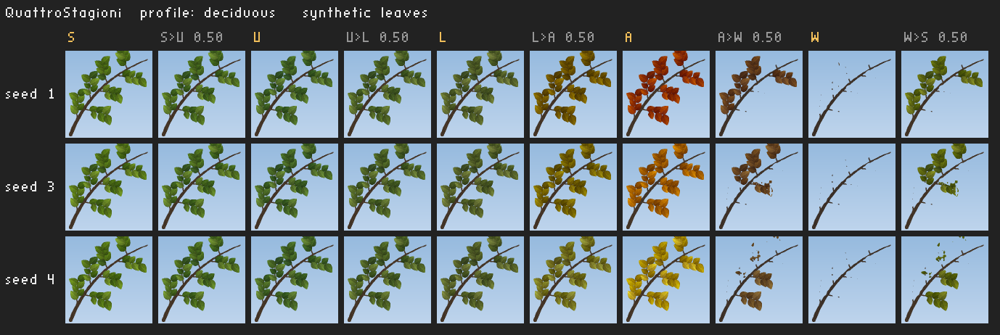
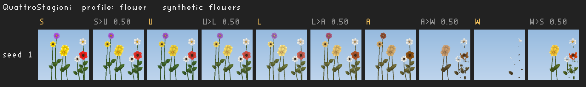
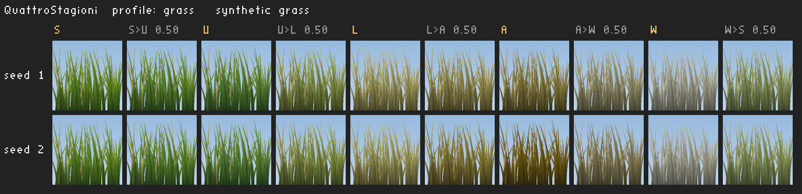

# QuattroStagioni

**Stagioni dinamiche per Crimson Desert (PC, Steam).** Pywel attraversa un anno vero: primavera
fiorita, l'estate del gioco originale, una fine estate secca e dorata, un autunno che accende i
boschi di giallo, arancio e rosso, un inverno di alberi spogli ed erba brinata. Il paesaggio cambia
un po' alla volta, giorno dopo giorno, con un calendario che regoli dal menu in gioco (**F5**).

> **Stato: in sviluppo, prime prove nel gioco riuscite.** Il pacchetto dell'autunno è stato
> generato sui file veri (43 secondi, 726 MB, fit 100%) e provato in gioco: autunno ben visibile,
> nessuna lettura rifiutata, menu F5 funzionante. Meteo, neve, luce e particelle non sono ancora
> agganciati. Vedi la tabella [Funzioni e stato](#funzioni-e-stato).


*Il menu F5 (scheda Calendario), qui ripreso nella demo dell'overlay fuori dal gioco.*

---

## Cosa fa

- **Cinque look stagionali** per alberi, arbusti, erba, fiori, coltivazioni e terreno, ottenuti con
  "ricette" di colore (spazio OKLab) applicate alle texture originali.
- **Transizioni graduali**: nella parte finale di ogni stagione il paesaggio passa alla successiva
  attraverso stadi intermedi.
- **Varietà**: ogni pianta cambia qualche giorno prima o dopo le altre e ha una propria tonalità
  autunnale, così un bosco non cambia colore tutto insieme.
- **Regioni**: il nord freddo ha un inverno anticipato e più lungo, paludi e giungla restano
  sempreverdi, il deserto resta com'è.
- **Menu F5** con calendario, durata delle stagioni, opzioni per regione, meteo e luce; tutto anche
  nel file `QuattroStagioni.ini`.
- **Sicura**: non scrive mai i file del gioco né i salvataggi. Controlla la versione all'avvio e,
  dopo una patch, si spegne da sola lasciando il gioco intatto.
- **Installazione pulita**: `qs_install.exe` trova il gioco, controlla versione, loader e altre mod,
  fa le copie di riserva e si disinstalla rimettendo tutto com'era.

### Anteprime delle ricette

Le immagini qui sotto mostrano le ricette applicate a **immagini di prova sintetiche** (non texture
del gioco), per tre semi diversi: da sinistra primavera, estate, fine estate, autunno, inverno e le
transizioni a metà strada.





---

## Installazione in breve

1. Installa [Ultimate ASI Loader](https://github.com/ThirteenAG/Ultimate-ASI-Loader/releases)
   x64: il file `dinput8.dll` del suo zip, rinominato `winmm.dll`, nella cartella `bin64` del gioco.
2. Scarica lo zip di QuattroStagioni dalla pagina [Releases](../../releases) ed estrailo dove vuoi.
3. Doppio clic su `qs_install.exe`.
4. Doppio clic su `genera_pacchetti.bat`: crea le texture stagionali sul tuo PC dai tuoi file.
5. Avvia il gioco e premi **F5**.

Guida completa, passo per passo: **[docs/utente/INSTALLAZIONE.md](docs/utente/INSTALLAZIONE.md)**.

| Guida | Contenuto |
|---|---|
| [INSTALLAZIONE](docs/utente/INSTALLAZIONE.md) | loader, antivirus, installazione, pacchetti, primo avvio, aggiornamento, disinstallazione |
| [GUIDA](docs/utente/GUIDA.md) | ogni opzione del menu F5 e ogni chiave del file ini |
| [PROBLEMI](docs/utente/PROBLEMI.md) | leggere il log, versione, pacchetti rifiutati, menu che non compare, altre mod, patch |
| [FAQ](docs/utente/FAQ.md) | domande frequenti |
| [CHANGELOG](CHANGELOG.md) | cosa cambia tra le versioni |

Requisiti: Crimson Desert **2.04.00** (Steam, anche con il DLC "Charting the Unknown"), Windows 10
o 11 a 64 bit, circa 6,5 GB liberi per le quattro stagioni principali (circa 30 GB con tutte le
transizioni).

---

## Funzioni e stato

| Funzione | Stato |
|---|---|
| Controllo di versione (eseguibile, `0.paver`, indici, archivi) | fatto, provato fuori dal gioco |
| Sostituzione sicura delle texture durante la lettura | **provata nel gioco** con il pacchetto dell'autunno (0 letture rifiutate) |
| Generatore dei pacchetti (`qs_gen`): lettura archivi, ricette, ricodifica a dimensione esatta | **provato sui file veri**: stadio A in 43 s, 726 MB, fit 100% |
| Elenco delle texture da cambiare (3688 texture) | fatto, da verificare sui file veri |
| Ricette dei colori (19 profili) | autunno **visto nel gioco**; le altre stagioni da provare e tarare |
| Calendario, stadi, transizioni, varietà, regioni | fatto, provato fuori dal gioco |
| Cambio automatico del pacchetto quando cambia lo stadio | fatto, provato fuori dal gioco |
| Menu F5 (5 schede, HDR, ReShade, Streamline) e salvataggio | **provato nel gioco** |
| Installatore, controllo, disinstallazione (`qs_install`) | fatto, provato sotto wine su una cartella di gioco finta |
| Sostituzione delle texture già caricate al cambio di stadio | da fare |
| Pacchetti diversi per regione e per singola pianta | da fare (oggi un pacchetto vale per tutto il mondo) |
| Meteo coerente con la stagione, neve che si accumula | calcolati dal motore, aggancio al gioco da fare |
| Luce stagionale, giornate più corte d'inverno | calcolate dal motore, aggancio al gioco da fare |
| Foglie che cadono, fiato visibile | calcolati dal motore, aggancio al gioco da fare |
| Orologio del gioco come sorgente del calendario | probe pronte, aggancio da fare |

---

## Come funziona

```
 file del gioco         qs_gen (sul tuo PC)                   pacchetti stagionali
 (.pamt / .paz)  --->   legge, applica le ricette,     --->   bin64\scripts\QuattroStagioni\packs\A.qsp ...
 (mai modificati)       ricodifica alla stessa misura

 Crimson Desert  --->   QuattroStagioni.asi (caricato da Ultimate ASI Loader)
                        - controllo di versione
                        - quando il gioco legge una texture della vegetazione, gli passa la
                          versione stagionale dal pacchetto (stessa dimensione, byte verificati)
                        - calendario e stadi, menu F5
```

Ogni texture stagionale ha esattamente la stessa dimensione dell'originale, mip per mip: gli
indici del gioco restano validi e nessun file viene riscritto. Se qualcosa non corrisponde (patch,
altra mod, file danneggiato), quella texture resta quella originale.

Documenti tecnici: [docs/DESIGN.md](docs/DESIGN.md) (visione e architettura),
[docs/GENERATORE.md](docs/GENERATORE.md) (uso di `qs_gen`), [docs/dev/](docs/dev/) (moduli e
interfacce), [docs/recon/](docs/recon/) (formati del gioco e ricerche).

### Compilare

Su Linux con `g++` e `mingw-w64` (wine facoltativo per i test Windows):

    ./build.sh test              # plugin, strumenti Windows e Linux, test
    tools/make_release.sh        # zip della release in build/release/

La CI su GitHub Actions compila e prova ogni push; un tag `v*` pubblica la release.

---

## Nota legale

QuattroStagioni è una mod amatoriale non ufficiale, non affiliata né approvata da Pearl Abyss.
Crimson Desert e i suoi contenuti sono di Pearl Abyss.

- Questo repository e le release **non contengono asset di Pearl Abyss**: niente texture, archivi,
  eseguibili o dati estratti dal gioco. Contengono solo codice, ricette di colore ed elenchi di
  percorsi e misure.
- Le texture stagionali vengono **generate sul PC di chi installa**, dai suoi file del gioco, e
  restano lì. Non condividere i pacchetti `.qsp`.
- La mod è pensata per il gioco in singolo giocatore e non modifica i file del gioco. Usala a tuo
  rischio, come ogni mod.

## Riconoscimenti e licenze

Componenti di terzi inclusi (testi completi in [THIRD_PARTY.txt](THIRD_PARTY.txt)):

| Componente | Uso | Licenza |
|---|---|---|
| [MinHook](https://github.com/TsudaKageyu/minhook) | agganci alle funzioni | BSD 2-Clause |
| [LZ4](https://github.com/lz4/lz4) | compressione degli archivi | BSD 2-Clause |
| [Dear ImGui](https://github.com/ocornut/imgui) | menu F5 | MIT |
| [rgbcx](https://github.com/richgel999/bc7enc_rdo) | codifica delle texture BC1-BC5 | MIT |
| [stb](https://github.com/nothings/stb) | immagini e caratteri di `qs_preview` | MIT / pubblico dominio |

Conoscenza dei formati (nessun codice copiato): [crimson-desert-unpacker](https://github.com/lazorr410/crimson-desert-unpacker)
di lazorr410 (MIT) e [pycrimson](https://github.com/LukeFZ/pycrimson) di LukeFZ (MIT).

Da usare insieme: [Ultimate ASI Loader](https://github.com/ThirteenAG/Ultimate-ASI-Loader) di
ThirteenAG (MIT).

Ispirazione: *Seasons of Pywel* di Khione95 e *Crimson Weather* di Nostyxx hanno aperto la strada
alle mod di stagioni e meteo per Crimson Desert. Il loro codice non ha licenza: QuattroStagioni non
ne contiene nessuna parte.

Progetto di Stefano ([Femapu](https://github.com/Femapu)).
