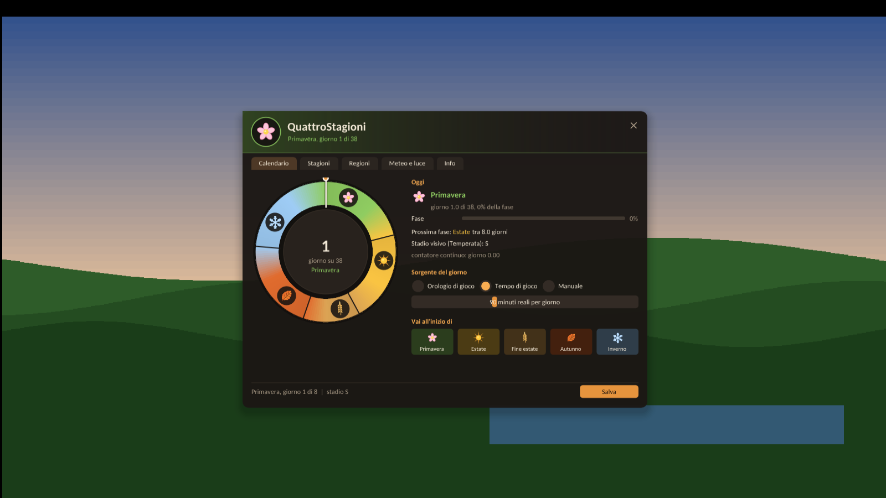

# Guida a QuattroStagioni: menu F5 e impostazioni

Tutto quello che si regola dal menu in gioco si trova anche nel file
`bin64\scripts\QuattroStagioni.ini` (si apre con il Blocco note). Il menu applica le modifiche
subito; il pulsante **Salva** in basso a destra le scrive nel file, così restano anche alla
prossima partita.

> **Cosa funziona oggi e cosa no.** Il calendario, gli stadi, le regioni e il cambio delle texture
> (con i pacchetti generati sul tuo PC) sono attivi. Meteo, neve, luce, durata del giorno e
> particelle vengono **calcolati** (li vedi nella scheda *Meteo e luce*, riquadro *Dal vivo*) ma
> **non sono ancora applicati al gioco**: gli agganci ai sistemi del gioco sono in sviluppo. Gli
> interruttori esistono già perché le tue scelte restino valide quando arriveranno.

## Come funziona, in due parole

- L'anno di QuattroStagioni ha cinque fasi: **Primavera**, **Estate**, **Fine estate** (secca),
  **Autunno**, **Inverno**, poi di nuovo primavera. L'estate è il gioco originale.
- Ogni fase dura un certo numero di **giorni di calendario**. Nell'ultima parte di ogni fase
  (la *coda di transizione*) il paesaggio passa gradualmente alla fase successiva attraverso alcuni
  **stadi intermedi**.
- A ogni stadio corrisponde un **pacchetto** di texture (`.qsp`) creato da `qs_gen` sul tuo PC.
  Quando il calendario cambia stadio, il plugin passa al pacchetto giusto. Se il pacchetto manca,
  quello stadio usa le texture originali.
- Le texture cambiano per tutto ciò che il gioco carica dopo il cambio di stadio: quello già
  visibile cambia quando il gioco lo ricarica.

Codici degli stadi (si vedono nel menu, nel log e nei nomi dei pacchetti):

| Codice | Stadio |
|---|---|
| `S` | Primavera: verde giovane, fioriture, erba fresca |
| `U` | Estate: il gioco originale (nessun pacchetto) |
| `L` | Fine estate secca: prati paglierini, campi dorati |
| `A` | Autunno: latifoglie gialle, arancio, rosse; prati bruno oliva |
| `W` | Inverno: alberi spogli, erba morta e brinata, conifere più scure |
| `A>W.2` | transizione da autunno a inverno, secondo stadio intermedio (file `A-W.2.qsp`) |

---

## Il menu F5

Si apre e si chiude con **F5** (anche **Esc** lo chiude). In alto vedi la stagione attuale e il
giorno dell'anno. Mentre il menu è aperto, mouse e tastiera servono al menu e non al gioco.

### Scheda Calendario

- **Ruota dell'anno**: le cinque fasi con la loro durata e un indicatore sul giorno di oggi.
- **Oggi**: fase attuale, giorno dell'anno, percentuale della fase già trascorsa, quale fase viene
  dopo e tra quanti giorni. Con il motore attivo mostra anche lo **stadio visivo** della regione
  temperata (per esempio `A` o `A>W.1`).
- **Sorgente del giorno**: come avanza il calendario.
  - *Orologio di gioco*: segue l'ora del gioco. **Non ancora agganciato**: finché non lo è, la mod
    usa il tempo di gioco (e il menu lo dice).
  - *Tempo di gioco*: il calendario avanza mentre giochi; il cursore sotto regola quanti **minuti
    reali** dura un giorno (da 5 a 240 nel menu).
  - *Manuale*: il calendario è fermo; il cursore sotto sceglie il giorno.
- **Vai all'inizio di**: cinque pulsanti per saltare all'inizio di una fase. Passano alla modalità
  *Manuale* (per far ripartire il tempo, scegli di nuovo *Tempo di gioco*).

Corrisponde a `DaySource`, `RealMinutesPerDay`, `StartDay` nel file.

### Scheda Stagioni

- **Lunghezza delle fasi**: giorni di ogni fase (da 1 a 60 nel menu). Sotto vedi quanto dura
  l'anno intero.
- **Coda di transizione**: quale parte finale di ogni fase è dedicata al passaggio alla successiva
  (da 0 a 90%).
- **Stadi intermedi**: quanti stadi ha ogni passaggio (da 0 a 6; 0 = cambio netto). Più stadi
  rendono il cambio più graduale ma richiedono più pacchetti, quindi più spazio su disco e più
  tempo di generazione.
- **Varietà per pianta**: di quanti giorni ogni pianta può anticipare o ritardare il proprio
  cambio, così un bosco non cambia colore tutto insieme.

> Se cambi *Stadi intermedi*, cambiano anche i nomi dei pacchetti di transizione: rigenera quelli
> che ti servono (`qs_gen.exe --list-stages --steps N` mostra l'elenco per N stadi).

### Scheda Regioni

Una scheda per regione, con:

- **interruttore**: regione spenta = sempre come il gioco originale;
- **spostamento**: anticipa (valori negativi) o ritarda il calendario della regione, fino a 15
  giorni nel menu;
- **cinque campi** (uno per fase, con l'icona della stagione): allungano (`x1.5`) o accorciano
  (`x0.7`) una fase in quella regione. Si regolano trascinando con il mouse. L'anno resta lungo
  uguale: le altre fasi si adattano.

| Regione | Predefinito |
|---|---|
| Temperata | ciclo completo |
| Nord freddo | inverno anticipato di 3 giorni e più lungo (x1,5), estate più corta |
| Palude e giungla | sempreverde, solo variazioni di umidità |
| Acquatica | variazioni minime |
| Deserto | escluso (sempre originale); attivarlo è sperimentale |
| Abisso | escluso (sempre originale); attivarlo è sperimentale |

> Oggi un pacchetto vale per tutto il mondo e segue lo stadio della regione **Temperata**. Le
> differenze tra regioni sono già calcolate (temperatura, meteo, neve) e verranno usate anche per
> le texture nelle prossime versioni.

### Scheda Meteo e luce

Colonna sinistra, **Cosa controlla la mod** (interruttori, oggi solo calcolati, vedi il riquadro
in cima alla pagina):

- **Meteo stagionale**: estati limpide, autunni piovosi e ventosi, inverni nevosi.
- **Neve che si accumula**: la copertura cresce quando nevica sotto zero e si scioglie sopra zero.
- **Luce stagionale**: sole più basso e toni freddi in inverno, più caldi in autunno.
- **Durata del giorno**: giornate più corte in inverno.
- **Particelle**: foglie che cadono in autunno, fiato visibile al freddo.

**Regolazioni**: velocità di accumulo e di scioglimento della neve, **latitudine virtuale** (più
alta = inverni più bui e sole più basso).

Colonna destra, **Dal vivo**: scegli una regione e vedi temperatura, manto nevoso, probabilità di
ogni tipo di tempo (sereno, nuvoloso, pioggia, temporale, neve, vento), alba e tramonto calcolati
dalla mod per oggi.

### Scheda Info

Versione della mod, stato dell'overlay, dell'orologio del gioco e del motore delle stagioni,
percorso del file di log con il pulsante **Copia percorso** (utile per le segnalazioni).

> In questa versione la scheda dice ancora "Pacchetto stagionale: non ancora disponibile": è un
> testo rimasto indietro. Lo stato reale dei pacchetti è nella riga in basso del menu
> (`stadio ... | pacchetto ...`) e nel log.

### In basso

La riga di stato (giorno, stadio, pacchetto attivo) e il pulsante **Salva**, che scrive le
impostazioni in `QuattroStagioni.ini`.

---

## Il file QuattroStagioni.ini

Si trova in `bin64\scripts\`. Righe che iniziano con `;` sono commenti. Decimali con il punto
(`0.4`); la virgola (`0,4`) è accettata. I valori fuori intervallo vengono corretti e segnalati nel
log. Dopo una modifica a mano, riavvia il gioco (o usa il menu, che applica subito).

### [General]

| Chiave | Predefinito | Significato |
|---|---|---|
| `Enabled` | 1 | 0 = la mod non fa nulla (nessun aggancio): il modo più rapido per spegnerla |
| `Substitute` | 1 | 0 = solo osservazione: agganci e log, nessuna texture cambiata |
| `LogLevel` | 1 | 0 solo errori, 1 informazioni (consigliato), 2 debug, 3 tutto |
| `MaxReadLogLines` | 3000 | con `LogLevel=2`, quante letture di archivi scrivere al massimo |
| `WaitForTargetReads` | 1 | 1 = una lettura asincrona che tocca una texture sostituita viene completata e corretta subito. Lasciare 1 |
| `SummaryIntervalSeconds` | 30 | ogni quanti secondi il log riassume letture e texture servite |

### [Packs]

| Chiave | Predefinito | Significato |
|---|---|---|
| `Active` | vuoto | vuoto = automatico (segue il calendario). Un codice (`A`, `W`, `A>W.2`) o un nome di file forza quel pacchetto all'avvio |
| `Folder` | `QuattroStagioni\packs` | cartella dei pacchetti, relativa a `bin64\scripts` oppure un percorso completo (per esempio `E:\QuattroStagioniPacks` su un altro disco; in quel caso genera i pacchetti lì con `qs_gen --out`) |
| `CacheMB` | 64 | memoria massima per i dati dei pacchetti tenuti in cache (0 .. 4096) |

### [Seasons]

| Chiave | Predefinito | Intervallo | Significato |
|---|---|---|---|
| `SpringDays`, `SummerDays`, `LateSummerDays`, `AutumnDays`, `WinterDays` | 8, 8, 5, 8, 9 | 0,5 .. 120 | durata di ogni fase in giorni di calendario |
| `TransitionFraction` | 0.4 | 0 .. 1 | parte finale di ogni fase dedicata al passaggio |
| `TransitionSteps` | 3 | 0 .. 8 | stadi intermedi per passaggio (0 = cambio netto) |
| `AssetJitterDays` | 2 | 0 .. 10 | varietà: anticipo o ritardo massimo di ogni pianta |
| `DaySource` | `playtime` | `playtime`, `gameclock`, `manual` | come avanza il calendario |
| `RealMinutesPerDay` | 90 | 1 .. 1440 | minuti reali per un giorno, con `playtime` |
| `StartDay` | 0 | 0 .. | giorno di partenza (0 = primo giorno di primavera); in `manual` è il giorno mostrato |
| `WeatherControl`, `SnowAccumulation`, `LightControl`, `DayLengthControl`, `Particles` | 1 | 0/1 | interruttori (oggi solo calcolati) |
| `SnowAccumPerHour` | 0.25 | 0 .. 5 | frazione di copertura per ora di gioco, quando nevica sotto zero |
| `SnowMeltPerHour` | 0.15 | 0 .. 5 | scioglimento a +3 gradi (più veloce se fa più caldo) |
| `VirtualLatitude` | 45 | 0 .. 65 | più alta = inverni più bui, sole più basso |
| `VanillaSunrise`, `VanillaSunset` | 3, 19 | 0 .. 10, 15 .. 24 | finestra del giorno del gioco originale (l'estate) |
| `BreathThreshold` | 5 | -20 .. 20 | sotto questa temperatura (gradi C) il fiato diventa visibile |

Con le durate predefinite l'anno dura 38 giorni: primavera dal giorno 0, estate dall'8, fine
estate dal 16, autunno dal 21, inverno dal 29. Con 90 minuti per giorno, un anno sono circa 57 ore
di gioco. Le temperature non scendono mai sotto i -30 gradi (il gioco infligge danni da freddo).

Il giorno raggiunto viene salvato ogni 30 secondi in `bin64\scripts\QuattroStagioni\state.ini`:
alla prossima partita il calendario riprende da lì. Per ripartire da `StartDay`, cancella quel file
a gioco chiuso.

### [Region.Nome]

Sezioni `Region.Temperate`, `Region.NorthCold`, `Region.SwampJungle`, `Region.Aquatic`,
`Region.DesertDry`, `Region.Abyss`.

| Chiave | Intervallo | Significato |
|---|---|---|
| `Enabled` | 0/1 | 0 = la regione resta sempre come in estate |
| `DayOffset` | -60 .. 60 | sposta il calendario della regione in giorni (negativo = in anticipo) |
| `SpringScale` ... `WinterScale` | 0,1 .. 5 | allunga (>1) o accorcia (<1) una fase; l'anno resta lungo uguale |
| `MeanTemp` | -40 .. 50 | temperatura media annua (gradi C) |
| `TempAmplitude` | 0 .. 40 | differenza tra la media e il cuore dell'inverno o dell'estate |
| `DailyAmplitude` | 0 .. 20 | metà dell'escursione tra giorno e notte |
| `Humidity` | 0 .. 1 | 0 secco, 1 molto umido (più pioggia e nuvole) |
| `Leaves` | 0 .. 2 | intensità delle foglie che cadono in autunno |

---

## Altri file

| File in `bin64\scripts\` | Cosa è |
|---|---|
| `QuattroStagioni.log` | registro dell'ultima partita (quella prima è in `QuattroStagioni.previous.log`) |
| `QuattroStagioni\state.ini` | giorno del calendario raggiunto (scritto dalla mod) |
| `QuattroStagioni\packs\*.qsp` | pacchetti stagionali generati sul tuo PC |
| `QuattroStagioni\probes.ini` | strumenti per sviluppatori, spenti (`Enabled=0`): non toccare |
| `QuattroStagioni\install\` | registro, copie di riserva e manifest dell'installatore (servono a disinstallare) |
| `..\winmm.ini` | impostazioni di Ultimate ASI Loader (`LoadPlugins=1`, `LoadFromScriptsOnly=1`) |

## Gli strumenti da riga di comando

| Comando | A cosa serve |
|---|---|
| `qs_install.exe --check` | controllo completo senza modifiche (anche `controlla.bat`, che salva il testo in `controllo.txt`) |
| `qs_install.exe --uninstall [--purge]` | disinstallazione (con `--purge` anche i pacchetti) |
| `qs_install.exe --game "<cartella>"` | indica la cartella del gioco se non viene trovata |
| `qs_install.exe --reset-config` | sostituisce il tuo `QuattroStagioni.ini` con quello nuovo (copia di riserva inclusa) |
| `qs_gen.exe --list-stages [--steps N]` | elenco degli stadi |
| `qs_gen.exe --game "<cartella>" --stage A --out "<cartella pacchetti>"` | genera un pacchetto |
| `qs_gen.exe --game "<cartella>" --verify-inventory --quick` | controlla che l'elenco delle texture corrisponda al gioco |
| `qs_gen.exe --check-pack "<pacchetto.qsp>" --game "<cartella>"` | verifica un pacchetto |
| `qs_season.exe` | prova del calendario fuori dal gioco (`--help` per le opzioni) |
| `qs_preview.exe` | anteprime delle ricette su immagini (`--help` per le opzioni) |
